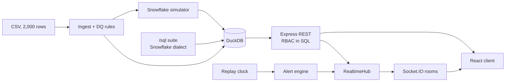

# Pure Insights Command Center

An admin dashboard for a custom analytics portal migrated off Tableau Server: report health,
orphaned reports, refresh failures, load latency and Snowflake/AWS cost attribution, with
real-time WebSocket alerts.

**Live demo:** https://pure-insights-command-center.onrender.com

**Video walkthrough:** <VIDEO_URL>

<GIF>

> Free Render tier: the service sleeps when idle, so the first load may take ~1 min. The app
> shows "Waking up the server..." until it responds.

## Demo credentials

These are public demo accounts. Anyone can sign in as admin, so the demo resets on every restart
or redeploy.

| role   | email                    | password     | can do                                                                                          |
| ------ | ------------------------ | ------------ | ----------------------------------------------------------------------------------------------- |
| admin  | `admin@pureinsights.dev` | `Admin@123`  | everything: assign owners, acknowledge any alert, replay controls, inject incidents, audit log  |
| owner  | `user_3@company.com`     | `Owner@123`  | only reports they currently own; acknowledge their alerts; full cost for those reports          |
| viewer | `viewer@pureinsights.dev` | `Viewer@123` | read-only; cost shown as portfolio aggregates only (no per-report dollars)                      |

## Evaluator's guide

| rubric item | where to look | what to try in 30 seconds |
| --- | --- | --- |
| **Full-stack architecture** | [docs/ARCHITECTURE.md](docs/ARCHITECTURE.md) (diagram and decisions table); `server/src/routes`, `server/src/repos`, `client/src/pages` | Sign in as the owner, open **Reports**: 11 reports, not 100. Then sign in as the viewer: lists load, but without per-report dollars. Both filters run in SQL, not in the UI. |
| **Real-time alerting and telemetry** | [docs/WEBSOCKET.md](docs/WEBSOCKET.md); `server/src/realtime`; the **Alerts** page and the bell | As admin, open **Alerts**, then use the header admin menu (replay controls, **Inject incident**) to inject one: a CRITICAL pop-up and bell entry arrive over the socket. Acknowledge it. Open the same page as the owner in a second window to see scoping. The replay advances one snapshot every 10 s. |
| **Cloud cost SQL attribution** | [sql/README.md](sql/README.md); `sql/03` to `sql/08`; the **Cost Attribution** page | On the cost page read the attribution flow (warehouse hour, query, report, dollars, cost per view) with its worked example. In [sql/08_reconciliation.sql](sql/08_reconciliation.sql) every check is PASS and `UNATTRIBUTED` is always present. |
| **Code quality and system docs** | [docs/API.md](docs/API.md), [docs/openapi.yaml](docs/openapi.yaml), `/api/docs` (Swagger UI), [docs/DATA_QUALITY.md](docs/DATA_QUALITY.md), `server/test` | Open `/api/docs`, run `POST /auth/login`, then call `GET /reports` as each role. Run `npm test` (533 tests). |

## Deliverables

1. **Codebase:** this repository. Project layout is [below](#project-structure).
2. **API documentation:** [docs/API.md](docs/API.md) (REST reference),
   [docs/WEBSOCKET.md](docs/WEBSOCKET.md) (event contract),
   [docs/openapi.yaml](docs/openapi.yaml) (generated from the route declarations, drift-tested),
   and interactive Swagger UI at `/api/docs` on the live app.
3. **SQL suite:** [sql/](sql/) holds Snowflake-dialect files 00 to 11 plus
   [sql/README.md](sql/README.md): query-level cost, report attribution, unit economics,
   anomalies, owner chargeback and reconciliation.

Also: [docs/ARCHITECTURE.md](docs/ARCHITECTURE.md) (decisions) and
[docs/DATA_QUALITY.md](docs/DATA_QUALITY.md) (findings and treatment).

## Architecture



Details, the realtime flow and the decisions table are in
[docs/ARCHITECTURE.md](docs/ARCHITECTURE.md).

## Key results

Every figure below was read from the running app, `data/dq_summary.json` or the SQL results.

**Data (see [docs/DATA_QUALITY.md](docs/DATA_QUALITY.md)).** 2,000 rows = 100 reports × 20
snapshots.

| finding | count |
| --- | ---: |
| rows with no owner (DQ01) | 245 |
| negative Snowflake credits, quarantined (DQ02) | 24 |
| loads slower than 15 s (DQ03) | 1490 |
| AWS cost per view outliers (DQ04) | 30 |
| zero-view rows (DQ05) | 4 |
| concurrent peak above monthly views (DQ06) | 93 |
| refresh status UNKNOWN (DQ07) | 100 |
| refresh SUCCESS but load above 15 s (DQ08) | 1004 |
| ownership changes between snapshots (DQ09) | 1782 |

Each report has 7 to 13 different owners over the 20 snapshots. At the last snapshot, 14 reports
are orphaned and `user_3@company.com` owns 11. AWS cost and views are nearly uncorrelated
(-0.027).

**Cost attribution.** 83,003 simulated queries carry 1,387,305.35 metered credits, which is
$4,161,916.06 at the assumed $3.00 per credit. At the last snapshot the cost page finds 14
orphaned reports (action: reassign) and 5 zombie reports with fewer than 50 views (action:
retire; 1 report is both), with estimated monthly savings of $259,639.07 from the zombies only.
The two chargeback views disagree where it matters: the `UNOWNED` line is 162,345 credits
point-in-time and 199,334 under the current owner, because of the ownership churn.

**Reconciliation.** 26 checks across `sql/08` to `sql/11`, all PASS: 5 CONSERVATION, 4
GROUND_TRUTH, and 17 CONSISTENCY. A failing check stops `npm run ingest` and server startup. The
9 DQ rules are also recomputed in SQL (`sql/02`) and compared with the TypeScript counts, all
PASS.

**Alert deduplication.** Over one full replay pass (snapshots 0 to 19), 1490 rows are slow, yet
the engine opens 168 `LATENCY` alerts. In total it opens 507 alerts (168 latency, 256 refresh
failed, 83 refresh unknown) for 2,154 rows that breach a rule (1490 slow + 564 failed or timed
out + 100 unknown). One alert per (report, rule) while active, with auto-resolve after 2 healthy
ticks and a 3-tick cooldown.

**Tests.** 533 tests in 31 files, all passing (`npm test`).

## Design decisions

- **Everything in the warehouse is checkable.** DQ rules exist twice (TypeScript and SQL) and
  must agree. Cost attribution is reconciled to the metered credit, with an always-present
  `UNATTRIBUTED` line. The server refuses to start on a failing check or stale results.
- **Access control lives in SQL.** Owner scoping is part of every query and every socket room.
  Viewer responses are parsed through a per-route schema that drops unlisted keys, so a new cost
  column is hidden by default.
- **Alerts are deterministic.** The replay tick is a function of wall time, and the alert state
  is rebuilt by replaying ticks, so restarts and tests are reproducible. A dedup state machine
  keeps 1490 slow rows from becoming 1490 alerts.

The full table, one line of rationale per decision, is in
[docs/ARCHITECTURE.md](docs/ARCHITECTURE.md#decisions).

## Assumptions

| assumption | where it applies |
| --- | --- |
| Snowflake credit price is **$3.00** | `CREDIT_PRICE_USD`; all dollar figures scale with it |
| **One snapshot = one day**; snapshot `i` is the UTC day 2026-09-21 + i (the CSV has no dates) | replay dates, daily cost, session timezone must be UTC |
| **Snowflake usage is simulated.** `QUERY_HISTORY` and `WAREHOUSE_METERING_HISTORY` are generated from the CSV credits, so attribution reconciles by construction | ground-truth checks G1 to G4 validate the SQL, not real-world accuracy |
| **Overhead is synthetic**: metered = query credits × (1 + 0.15). It is not measured idle time | `SIMULATED_OVERHEAD_RATE`; the active vs overhead split |
| A report maps to one of three warehouses by hash of its id | simulator only |
| Cost per view is on a **30-day basis**: daily Snowflake cost × 30 + AWS (assumed a monthly bill), divided by monthly views | `/sql/05` |
| Zombie savings are daily cost × 30, **at the simulated scale**. The CSV credits are far larger than three small warehouses could burn, so the dollar amounts are illustrative | `/sql/06` |
| Thresholds (15 s, 30 s, 50 views, $300, z 3.5) are judgment calls | `server/src/config.ts` |
| Owner = the latest snapshot's owner unless an admin override exists | `REPORT_CURRENT_OWNER` |

Production would use Snowflake's native query attribution view; this suite is the transparent
manual equivalent.

## Known limitations

- **Acks, incidents, pause and speed are in memory.** A restart forgets them, and acks reset when
  the replay wraps to snapshot 0 (alert ids include the cycle). Alerts derived from the
  snapshots are rebuilt exactly.
- **Overrides and the audit log live in `data/warehouse.duckdb`.** Re-running `npm run ingest` or
  redeploying on Render rebuilds the warehouse and clears them.
- **Public admin credentials.** Anyone can reassign owners or pause the replay on the demo.
- **Logout does not revoke a JWT** (stateless, 8 h). The client disconnects its socket on logout;
  an open socket otherwise stays connected until the token expires.
- **Single instance.** The login limiter and socket state are per process. Scaling out needs a
  shared store and the Socket.IO Redis adapter.
- **Events are not replayed after a disconnect.** Clients re-sync with `GET /alerts` on
  reconnect.
- **Owner reassignment race.** A tick landing in the milliseconds between the override commit and
  the owner-map refresh can send a reassigned report's alert to its former owner once, before a
  corrective `alert:snapshot`.
- **Unauthenticated sockets** can hold an empty Engine.IO session until the 45 s connect timeout.
- **Old browsers** that do not send `Sec-Fetch-Site` are rejected in production over polling; the
  WebSocket transport still works for them.
- **Quarantined snapshots have unknown cost** (24 of them), so cost totals are a lower bound.
- **Free-tier cold start** of up to about a minute.
- **No Docker or devcontainer files** are included; local runs use npm.

More detail: [API.md](docs/API.md#known-limitations) and
[WEBSOCKET.md](docs/WEBSOCKET.md#known-limitations).

## Run locally

Requires Node 24 (`.nvmrc`).

```bash
npm ci
npm run ingest      # builds data/warehouse.duckdb from the CSV, runs the SQL suite, checks it
npm run dev         # API on :3000, client on http://localhost:5173
```

Production-style:

```bash
npm run build && npm run ingest
JWT_SECRET=$(openssl rand -hex 32) NODE_ENV=production npm start   # http://localhost:3000
```

Without `JWT_SECRET` outside production, a random key is generated per process. Re-run
`npm run ingest` after editing any file in `sql/`, a parameter in `server/src/config.ts` or a DQ
rule; the server exits with a message if the stored results are stale.

| command | what it does |
| --- | --- |
| `npm run dev` | shared types in watch mode, API with `tsx watch`, Vite client |
| `npm run build` | builds shared, server and client |
| `npm start` | runs the built server (serves `client/dist`) |
| `npm run ingest` | rebuilds the warehouse, DQ summary and SQL results |
| `npm run openapi` | regenerates [docs/openapi.yaml](docs/openapi.yaml) from the routes |
| `npm run ws-smoke -- --seconds 30 --inject` | signs in as the three roles and checks socket scoping |
| `npm run typecheck` / `npm run lint` | TypeScript and ESLint |

## Tests

```bash
npm test
```

533 tests in 31 files (Vitest and Supertest, run sequentially to bound DuckDB memory). They
cover:

- the DQ rules and the ingest facts of the real CSV, including the `dq_summary.json` drift check
- the SQL suite and its reconciliation, and the Snowflake to DuckDB translator
- the access matrix (every endpoint × anonymous, viewer, owner, admin), owner scoping, viewer
  redaction and owner overrides
- the alert engine, the hub, socket rooms and the replay clock
- OpenAPI drift, and UI logic such as notification rules and status colour contrast

## Project structure

```
client/             React + TypeScript (Vite), TanStack Query, Recharts, Tailwind v4
  src/pages/        Overview, Reports, Alerts, Cost Attribution, Data Quality
  src/realtime/     Socket.IO provider
server/             Express 5 + TypeScript (ESM), Socket.IO
  src/ingest/       CSV, normalization, DQ rules, Snowflake simulator
  src/sql/          runner, translator and fingerprint for /sql
  src/realtime/     clock, alert engine, hub, socket
  src/routes/       REST routers (declared with defineRoute)
  src/repos/        scoped SQL access
  test/             Vitest + Supertest
shared/             types shared by client and server (@pic/shared)
sql/                Snowflake SQL suite 00-11 and README
docs/               ARCHITECTURE, API, WEBSOCKET, DATA_QUALITY, openapi.yaml
data/raw/           the source CSV; data/dq_summary.json is generated and committed
scripts/            ws-smoke.ts
render.yaml         Render blueprint
```
