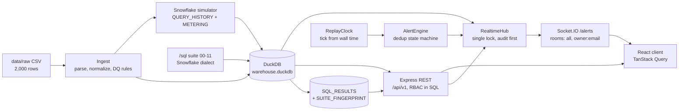
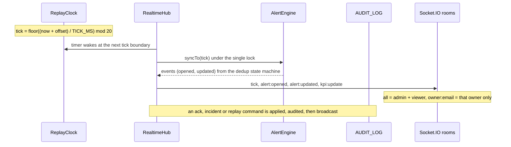

# Architecture

How the pieces fit and why they were built this way. Reference material lives elsewhere:
[API.md](API.md) (REST), [WEBSOCKET.md](WEBSOCKET.md) (event contract),
[DATA_QUALITY.md](DATA_QUALITY.md) (findings and treatment), [sql/README.md](../sql/README.md)
(the cost attribution suite).

## System overview

`npm run ingest` runs the left half once at build time: it parses and cleans the CSV, applies
the DQ rules, simulates Snowflake's `ACCOUNT_USAGE` views, runs the SQL suite, and stores the
verified results. The server only **reads** that state at startup. The right half runs per
request and per tick.

## Request path

Route order in `server/src/app.ts`: `/health`, then `/api/v1`, then a JSON 404 for any other
`/api` path, then static `client/dist`, then the SPA fallback, then the JSON error middleware.
The Express app is wrapped in `http.createServer` so Socket.IO can attach to the same port.

Each endpoint is declared once with `defineRoute` (`server/src/http/route.ts`): method, path,
allowed roles, zod input and output schemas. The same declaration feeds request validation,
response validation (outside production), the access check, the viewer redaction and the
generated [`openapi.yaml`](openapi.yaml). Repository methods take a required `Scope`, so an
unscoped query does not compile.

## Realtime flow

1. **Clock.** `ReplayClock` derives `{tick, cycle}` from virtual time
   (`anchorVirtual + (now - anchorReal) x speed`). Nothing counts ticks. Pause, resume and speed
   only re-anchor, so the tick never jumps. `TICK_MS` is 10,000 and there are 20 snapshots, so a
   full pass takes 200 s at speed 1.
2. **Engine.** `AlertEngine.syncTo(tick)` is synchronous. It steps forward through the ticks it
   missed, or rebuilds from tick 0 when the cycle changed. Rules are pure functions of one
   reading (`LATENCY`, `REFRESH_FAILED`, `REFRESH_UNKNOWN`), and the state machine applies
   dedup, escalation, auto-resolve and cooldown.
3. **Hub.** `RealtimeHub.sync()` is the only place that syncs the engine and publishes. A REST
   request that crosses a tick boundary and the timer both go through it, so no event is lost to
   whichever caller syncs first. Every state change (sync, ack, incident, replay command, owner
   refresh) runs on one promise-chain lock, and is broadcast only after its audit row is written.
   If the audit write fails, the change is undone and nothing is sent.
4. **Rooms.** Admin and viewer sockets join `all`. An owner socket joins `owner:<email>`. Each
   alert goes to `all` plus the room of its report's **current** owner. The server picks the room
   from the session; clients cannot join rooms.

Event payloads and ack codes are specified in [WEBSOCKET.md](WEBSOCKET.md).

## Decisions

| decision | why |
| --- | --- |
| **Single Render web service** serving API, Socket.IO and the built client | One free service, one origin: no CORS, cookies work without extra config, and the WebSocket needs no second host. The trade-off is a cold start on the free plan. |
| **DuckDB as the Snowflake stand-in** | It runs the Snowflake-dialect SQL in-process, with no account or cost. Four documented translations in `server/src/sql/translate.ts` cover the differences, and the translator throws if a Snowflake-only construct is left in. Production would point the same files at `SNOWFLAKE.ACCOUNT_USAGE`. |
| **Deterministic replay clock** | Tick is a pure function of wall time plus an offset, so a restart reproduces the same alert state by replaying ticks 0..now, and tests need no timers. |
| **Alert dedup state machine** (OPEN, ACKNOWLEDGED, RESOLVED) | 74.5% of rows breach 15 s, so alerting per row would bury the signal. One alert per (report, rule) while active, escalation only, auto-resolve after 2 healthy ticks and a 3-tick cooldown give a stable, ackable list. |
| **Cookie auth and Socket.IO rooms** | The JWT sits in an httpOnly, SameSite=Lax cookie that scripts cannot read and that is never in a response body. The socket handshake reuses it. Production checks Origin against Host for writes and for the handshake. Rooms make scoping a server decision. |
| **Owner scoping in SQL** | The filter is part of every query, including `COUNT(*)`, and an out-of-scope report is a 404. Nothing is fetched and then filtered, so a missed filter cannot leak rows. |
| **Materialized `/sql/03` tables** | Query-level cost is a range join of 83,003 queries against hourly metering. As a view it was re-derived inside every later file, and file 08 alone exceeded the 256 MB DuckDB limit. Two tables, rebuilt on every ingest, fix that. On Snowflake this layer would be a scheduled task or dynamic table. |
| **Stored SQL results plus `SUITE_FINGERPRINT`** | Ingest runs the suite, fails on any FAIL, and stores the results with a sha256 over every `/sql` file and parameter. Startup only loads and re-asserts them, which keeps the cold start short and refuses results built from different inputs. Ownership-dependent row sets are read from live views so overrides show immediately. |
| **CONSERVATION vs GROUND_TRUTH checks** | Conservation checks (C1 to C5) hold on any correct allocation over real logs: no credit is created, lost or double counted. Ground-truth checks (G1 to G4) hold only because the simulator knows the answer. Keeping them apart says honestly what each proves. See [sql/README.md](../sql/README.md#what-the-reconciliation-proves-and-what-it-doesnt). |
| **Untagged spend never dropped** | Attribution and both chargebacks carry an always-present `UNATTRIBUTED` line, so on a real account with untagged analyst queries the totals still reconcile. It is 0 here because the simulator tags every query. |
| **Admin-only point-in-time chargeback** | That view charges each past snapshot to whoever owned it then. With 7 to 13 owners per report it would show an owner dozens of reports they no longer own, breaking "owners see only reports they currently own". Owners get the current-owner view; viewers get redacted counts. |
| **Fail-closed viewer redaction** | Viewer responses are always parsed through a per-route viewer schema, and zod drops every key it does not list. A cost column added to a query later is hidden by default. A viewer-reachable route without a schema fails at startup. A test also scans every viewer response for cost-like keys. |
| **Audit before broadcast, undo on failure** | Every admin change (owner override, ack, incident, replay command) is applied, audited, then published. If the audit row cannot be written the change is withdrawn, so state clients see always has an audit record. |
| **One declaration per route** (`defineRoute`) | Validation, RBAC, redaction and the OpenAPI document come from the same object, so they cannot drift. A test fails if `openapi.yaml` is stale or a route is missing from the access matrix. |
| **Data quality implemented twice** | TypeScript rules at ingest and an independent SQL recomputation (`DQ_CHECKS`) must agree, or ingest and startup fail. See [DATA_QUALITY.md](DATA_QUALITY.md). |

## Cost attribution in one paragraph

Snowflake bills warehouses by the hour, not queries. For each warehouse-hour, the metered
credits are split across the queries that overlapped it, weighted by execution time (a query
crossing an hour boundary is split by overlap). Query cost rolls up to a report through its
`QUERY_TAG`, and to an owner through `REPORT_CURRENT_OWNER`. Reconciliation then proves the
totals match at every level. Production would use Snowflake's native
`QUERY_ATTRIBUTION_HISTORY`; this suite is the transparent manual equivalent. Full detail is in
[sql/README.md](../sql/README.md).

## Known trade-offs

The consolidated list is in the [README](../README.md#known-limitations). The ones that shape
the design:

- **Acks, incidents, pause and speed are in memory.** Alert state derived from the snapshots is
  rebuilt after a restart, but acks and incidents are lost, and they reset when the replay wraps.
  One instance means no shared state to lose; scaling out would need a shared store.
- **Overrides and the audit log live in the DuckDB file**, which a redeploy rebuilds.
- **The warehouse is rebuilt at deploy time** (`npm run ingest` in the build), not at startup.
  Startup stays fast, at the price of a rebuild for any rule, SQL or parameter change.
