# WebSocket API (real-time alerts)

Alerts, replay ticks and KPI updates are pushed over **Socket.IO** on the namespace
**`/alerts`**, served from the same origin and port as the REST API. Types for every payload are
in `@pic/shared` (`ServerToClientEvents`, `ClientToServerEvents`). The REST side of alerts
(`GET /alerts`, `POST /alerts/:id/ack`, replay and incident controls) is in [API.md](API.md).

Code: `server/src/realtime/socket.ts` (transport, auth, rooms) and `server/src/realtime/hub.ts`
(what is emitted and when). Tests: `server/test/realtime/socket.test.ts`.

## Connecting

```ts
import { io } from 'socket.io-client';
// In the browser, after POST /api/v1/auth/login has set the session cookie:
const socket = io('/alerts'); // same origin; the browser sends the pic_token cookie
```

|            |                                                                                                                                                                                                                                                                                                                                                                                                                                |
| ---------- | ------------------------------------------------------------------------------------------------------------------------------------------------------------------------------------------------------------------------------------------------------------------------------------------------------------------------------------------------------------------------------------------------------------------------------ |
| Credential | The **`pic_token` session cookie** set by `POST /api/v1/auth/login`, sent by the browser with the same-origin handshake. A token in the Socket.IO `auth` payload or an `Authorization` header is **not** accepted.                                                                                                                                                                                                             |
| Validation | The same check as REST: valid HS256 signature, not expired, and the account exists with the role in the token.                                                                                                                                                                                                                                                                                                                 |
| Origin     | In production, the handshake must carry an `Origin` whose host equals the `Host` header, so a page on another site can't open a socket that rides on the user's cookie (cross-site WebSocket hijacking). Socket.IO's default polling transport opens with a same-origin GET, on which browsers send no `Origin`; that request is accepted only with the browser-set `Sec-Fetch-Site: same-origin` (page scripts can't set it). |
| Expiry     | The server disconnects the socket when the session's JWT expires (reason `io server disconnect`); sign in again to reconnect.                                                                                                                                                                                                                                                                                                  |
| Errors     | A rejected handshake fires `connect_error` with `err.message` = code and `err.data = { code, message }`: `UNAUTHENTICATED` or `BAD_ORIGIN`. The default namespace `/` rejects every connection (`NOT_FOUND`).                                                                                                                                                                                                                  |

Non-browser clients send the cookie themselves; see `scripts/ws-smoke.ts`
(`extraHeaders: { cookie, origin }`).

## Rooms and scoping

| role   | room            | receives                                                                         |
| ------ | --------------- | -------------------------------------------------------------------------------- |
| admin  | `all`           | every alert                                                                      |
| viewer | `all`           | every alert (alerts and KPIs contain no per-report cost, so nothing is redacted) |
| owner  | `owner:<email>` | only alerts on reports whose **current** owner is their email                    |

A socket joins exactly one room, chosen by the server from the session; clients can't join
rooms. Each alert event goes to `all` plus `owner:<ownerEmail>` (orphaned reports, with a null
owner, go to `all` only). `ownerEmail` is the report's current owner at the moment of the event,
the same definition as REST (`REPORT_CURRENT_OWNER`, including admin overrides).

Every payload is parsed through the same zod schema as the matching REST response before it is
sent. That schema is also the viewer schema for alerts and the overview, so an unexpected field
is stripped rather than leaked (the same fail-closed rule as REST).

## Server → client events

| event            | payload                                                              | when                                                                                                                                                                                                                   |
| ---------------- | -------------------------------------------------------------------- | ---------------------------------------------------------------------------------------------------------------------------------------------------------------------------------------------------------------------- |
| `tick`           | `{ tick, snapshotDate, paused }`                                     | On connect; whenever the replay moves to a new snapshot; on pause/resume.                                                                                                                                              |
| `alert:snapshot` | `Alert[]`: the **active** (OPEN + ACKNOWLEDGED) alerts in your scope | On connect, and again whenever the set changes wholesale: the replay wraps to snapshot 0 (new cycle), an admin reassigns a report's owner, or a failed owner refresh succeeds on retry. **Replace** your list with it. |
| `alert:opened`   | `Alert`                                                              | A new alert opens (from a snapshot reading or an injected incident).                                                                                                                                                   |
| `alert:updated`  | `Alert`                                                              | An alert escalates (WARNING → CRITICAL), is acknowledged, or resolves.                                                                                                                                                 |
| `kpi:update`     | `OverviewKpis` (same as `GET /overview`)                             | On connect; after each tick; after any alert change in your scope.                                                                                                                                                     |

On connect the order is always `tick`, `alert:snapshot`, `kpi:update`. The socket joins its room
and receives the snapshot in one step, so every later alert event is a delta on top of that
snapshot.

**Client rules**

- Treat `alert:opened` and `alert:updated` as **upserts by `id`**: an update for an id you don't
  hold yet is a new row.
- `alert:snapshot` replaces the list. RESOLVED alerts are not in snapshots; fetch history with
  `GET /api/v1/alerts`.
- **After every reconnect**, re-sync with `GET /api/v1/alerts` (and `GET /api/v1/overview`).
  Events emitted while you were disconnected are not replayed; the reconnect's own
  `alert:snapshot` also brings the active set back.
- Several ticks may pass at once (a server wake-up, or a high replay speed). The server applies
  them in order and sends their events in order, followed by one `tick` for the latest snapshot.

Example `alert:opened`:

```json
{
  "id": "8958284-RPT_203-LATENCY-7",
  "reportId": "RPT_203",
  "reportName": "Analytics Dashboard 4",
  "ownerEmail": "user_3@company.com",
  "ruleId": "LATENCY",
  "severity": "CRITICAL",
  "status": "OPEN",
  "message": "Load time 55s > 30s",
  "value": 55,
  "threshold": 30,
  "openedTick": 7,
  "openedAt": "2026-10-10T18:27:50.000Z",
  "lastSeenTick": 7,
  "streak": 1,
  "synthetic": true
}
```

`streak` is the number of consecutive snapshots, ending at `lastSeenTick`, on which the report
broke this rule. It counts breaches whether or not an alert was active, so an alert that reopens
after a cooldown can start above 1. It moves every tick without an event (like `lastSeenTick`);
the value in `alert:opened` / `alert:updated` is the streak at that moment.

## Notifications in the client

Every alert that opens or escalates live produces a notification. The server sends it as
`alert:opened` (or `alert:updated` for WARNING → CRITICAL); the client decides where it goes
(`client/src/lib/notifications.ts`, unit-tested in `server/test/ui/notifications.test.ts`):

| alert                                                              | bell | pop-up card        |
| ------------------------------------------------------------------ | ---- | ------------------ |
| `LATENCY` WARNING (> 15 s)                                         | yes  | no                 |
| `LATENCY` CRITICAL (> 30 s), `REFRESH_FAILED` (FAILED / TIMED_OUT) | yes  | yes (unless muted) |
| `REFRESH_UNKNOWN` (INFO), acks, resolutions                        | no   | no                 |

- One notification per alert id **and severity**: an escalation notifies again, an ack does not.
  Alerts in an `alert:snapshot` (connect, reconnect, new cycle) are already active, so they are
  not news and don't notify.
- **Bell** (header): unread count, the 20 most recent notifications (severity, report, value vs
  threshold, snapshot), "Mark all read", and a "Mute critical pop-ups" toggle stored in
  `localStorage` (`pic.mutePopups`; falls back to unmuted when storage is unavailable).
  Notifications live in memory for the session and start empty after a reload.
- **Pop-up card**: one CRITICAL at a time with "+N more" for the queue. Shows severity, report
  name and id, owner, value vs threshold and the streak ("3rd snapshot in a row"), with View
  report and Acknowledge (admin, or the owner of the report; viewers never see the button).
  Closes after 8 s; hovering or focusing pauses the countdown.
- Dedup and cooldown still apply (see the lifecycle below): a report that stays slow has one
  alert, so it notifies once (and again on escalation), not every tick. A breach during the
  3-tick cooldown opens no alert and so does not notify; it does count toward the next streak.

## Client → server: `alert:ack`

```ts
const res = await socket.emitWithAck('alert:ack', { alertId });
// { ok: true, alert }  or  { ok: false, error: { code, message } }
```

| code              | meaning                                                                                                           |
| ----------------- | ----------------------------------------------------------------------------------------------------------------- |
| `FORBIDDEN`       | Viewers can't acknowledge.                                                                                        |
| `NOT_FOUND`       | No such alert in this replay cycle, **or** it belongs to another owner (owners can't probe other owners' alerts). |
| `CONFLICT`        | The alert already resolved.                                                                                       |
| `BAD_REQUEST`     | The payload isn't `{ alertId: string }`.                                                                          |
| `UNAUTHENTICATED` | The session expired (the socket is then disconnected).                                                            |
| `INTERNAL`        | Anything else, e.g. the audit row couldn't be written (the ack is then withdrawn).                                |

Socket and REST acks share one code path (`RealtimeHub.ack`). The ack is applied, an
`ALERT_ACK` row is written to the audit log, and only then is `alert:updated` broadcast to every
room that can see the alert. Acknowledging an already-acknowledged alert is idempotent
(`ok: true`, no new audit row, no event).

Bulk acks (`POST /alerts/ack`, REST only; see [API.md](API.md)) run on the same lock
(`RealtimeHub.ackMany`). They write one `ALERT_ACK_BULK` audit row, and only then send one
`alert:updated` per changed alert, each to the rooms that can see that alert, so an owner hears
only about their own alerts.

## Alert lifecycle

```mermaid
stateDiagram-v2
  [*] --> OPEN: rule violated (not in cooldown, or incident)
  OPEN --> OPEN: violated again → lastSeenTick; peak value; escalation emits alert:updated
  OPEN --> ACKNOWLEDGED: alert:ack / POST /alerts/:id/ack
  ACKNOWLEDGED --> ACKNOWLEDGED: escalation keeps the ack, emits alert:updated
  OPEN --> RESOLVED: 2 consecutive healthy ticks
  ACKNOWLEDGED --> RESOLVED: 2 consecutive healthy ticks
  RESOLVED --> [*]: key may reopen after 3-tick cooldown (incidents bypass it)
```



| rule              | fires on                  | severity           |
| ----------------- | ------------------------- | ------------------ |
| `LATENCY`         | load time > 15 s / > 30 s | WARNING / CRITICAL |
| `REFRESH_FAILED`  | FAILED or TIMED_OUT       | CRITICAL           |
| `REFRESH_UNKNOWN` | UNKNOWN                   | INFO               |

- **Dedup key** (`reportId`, `ruleId`): while an alert for the key is OPEN or ACKNOWLEDGED, new
  violations update it instead of opening another. About 75% of snapshot rows breach 15 s,
  yet a report that stays slow has **one** LATENCY alert, not one per tick (unit test
  "75% of rows breach 15 s", plus an invariant test over the real CSV).
- **Escalation only**: a milder reading never lowers severity; `value` and `message` keep the peak.
- **Auto-resolve** after 2 consecutive healthy ticks; **cooldown** of 3 ticks before the key can
  reopen.
- **Injected incidents** (`POST /admin/incidents`) apply a synthetic reading at the **current**
  tick (55 s latency or a FAILED refresh) and bypass the cooldown. Their events are broadcast as
  soon as the incident's audit row is written, not deferred to the next tick, so they also work
  while the replay is paused. An alert that an incident opened has `synthetic: true`.

## Replay clock and timer

`tick = floor(virtualNow / TICK_MS) % 20`, where virtual time is wall time adjusted by
pause/speed anchors; nothing counts ticks. The server sets a timer for the next tick boundary at
the current speed. When it fires, the server syncs the alert engine to the clock and broadcasts
the resulting events. A REST request that arrives first syncs and broadcasts the same way, so an
event is never lost to whichever caller happens to sync first. Pause cancels the timer;
resume and speed changes re-arm it and broadcast `tick`.

All state changes (timer syncs, acks, incidents, replay commands, owner refreshes) run one at a
time on a single queue. A change that is rolled back (its audit row failed) is therefore never
broadcast, and no tick can be published between a change and its rollback.

## Restart and failure behaviour

- **Restart reproducibility covers the readings only.** Alerts derived from the 20 snapshots are
  rebuilt by replaying ticks 0..now, so a restart (or a fresh engine) reproduces them exactly
  (tested on the real CSV). **Acks and injected incidents live in memory**: a restart forgets
  them, and they also reset when the replay wraps to snapshot 0 (alert ids include the cycle).
  Pause and speed are in memory too; a restart resumes at speed 1 from wall time.
- **Owner refresh failures are retried.** After `PATCH /reports/:id/owner`, the server re-reads
  current owners to route alerts. If that read fails, the override is still committed and the
  map is marked stale. The next sync (timer or request) retries it, and until it succeeds syncs
  fail without publishing, so no event is routed to a report's former owner. Once it succeeds,
  every room gets a fresh `alert:snapshot`.
- Clients that miss events (disconnect, server restart) recover with the reconnect snapshot and
  `GET /api/v1/alerts`.

## Smoke test

```bash
npm run dev                                   # or npm run build && npm start
npm run ws-smoke -- --seconds 30 --inject     # optional base URL as the first argument
```

The script signs in as admin, owner (`user_3`) and viewer, prints every event each receives,
and then checks scoping:

- the owner only saw alerts on their reports;
- the owner saw nothing the admin didn't;
- the viewer saw exactly what the admin saw.

With `--inject` it also injects a latency spike on one owned and one non-owned report and checks
who heard about each. That writes audit rows, so it is opt-in. The script exits 1 on any
violation.

## Known limitations

- Acks, incidents, pause and speed are in memory (see above). The deployment is one free Render
  instance, so there is no shared state to lose between instances; scaling out would need the
  Socket.IO Redis adapter and a shared store for acks.
- Logging out clears the cookie but doesn't revoke the JWT, so an open socket stays connected
  until the token expires (8 h) unless the client disconnects it. Tokens are stateless; there is
  no server-side revocation list.
  **The client must disconnect its socket on logout** (and reconnect after the next login);
  otherwise a second user signing in in the same tab could keep receiving the first user's
  `owner:` stream.
- Events are not replayed after a disconnect; clients re-sync over REST.
- An owner reassignment commits before the hub re-reads the owner map. A tick that lands in
  that window (milliseconds) can still send the reassigned report's alerts to its former owner
  once, before the corrective `alert:snapshot`. A fix would run the override write inside the
  hub's lock or mark the owner map stale before writing.
- The Origin and cookie checks run in the namespace middleware, so an unauthenticated client can
  open an Engine.IO session that holds no data and lasts until the connect timeout (45 s) after
  its rejected namespace connect. Checking in `allowRequest` as well would close that.
- Browsers too old to send `Sec-Fetch-Site` (before roughly 2021–2023, depending on the browser)
  are rejected in production when they connect over polling; the WebSocket transport still
  works for them.
